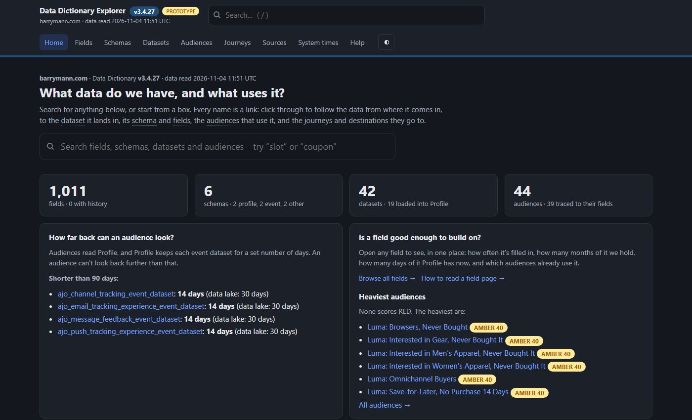
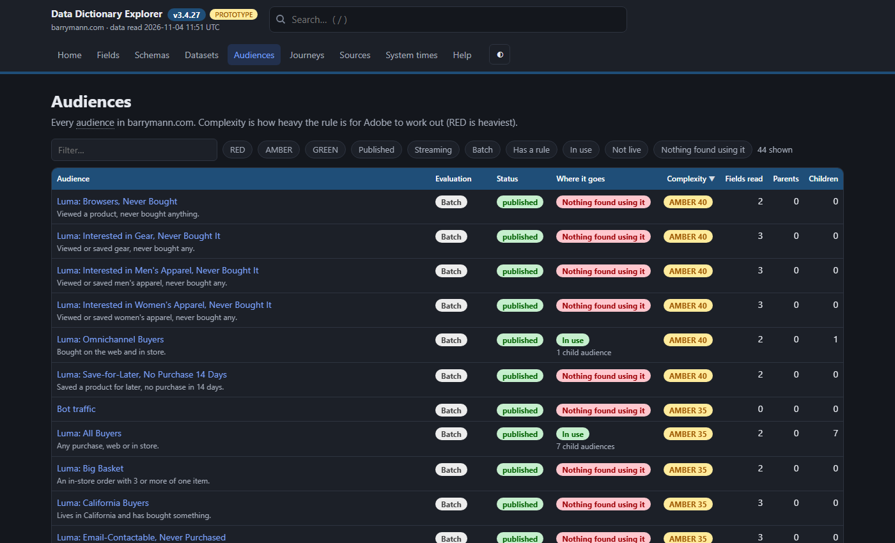
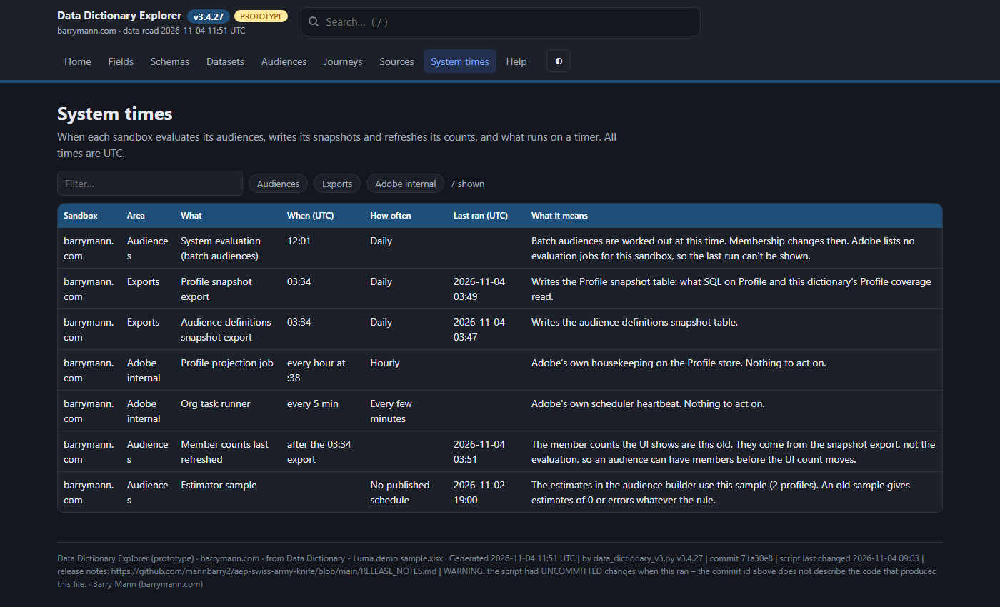

# Try the Data Dictionary Explorer

## [▶ Open the live Explorer](https://mannbarry2.github.io/aep-swiss-army-knife/samples/luma-demo/explorer.html)

Click the link and it runs in your browser. There's nothing to download and no Adobe login.

Everything here is Adobe's fictional Luma retail demo data, so explore as much as you like.

## Things to try

**Start at Home.** Search for any field, or click a box to find out what data you have and what uses it.

**Open Audiences.** Every audience shows how heavy its rule is and where it goes. Click one to read the rule.

**Open System times.** See when audiences are evaluated and when snapshots are written.

## Want the files?

- [`explorer.html`](explorer.html): the same Explorer. Download it and double-click, and it works offline.
- [`Data Dictionary - Luma demo sample.xlsx`](Data%20Dictionary%20-%20Luma%20demo%20sample.xlsx): the Excel workbook it's built from.

This is a snapshot from 2026-11-04. The sandbox's own website datasets were removed before publishing, so a few totals may not match the rows you see.

To build one for your own sandbox, see [`data_dictionary_v3.py`](../../data_dictionary_v3.py).
